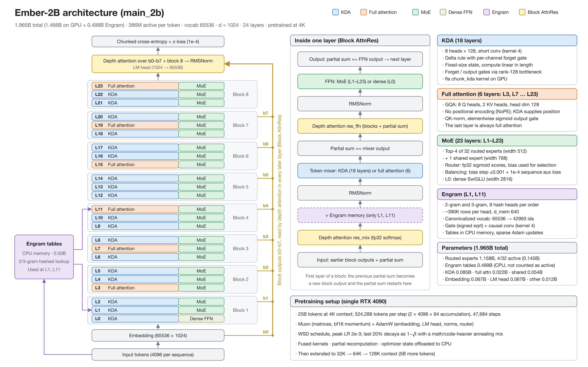

# Ember-2B-base

After reading [Kimi Linear: An Expressive, Efficient Attention Architecture](https://arxiv.org/abs/2510.26692), [Attention Residuals](https://arxiv.org/abs/2603.15031), [Conditional Memory via Scalable Lookup: A New Axis of Sparsity for Large Language Models](https://arxiv.org/abs/2601.07372) and the [DeepSeek-V4.1-Flash report](https://arxiv.org/abs/2609.19969). Based on my own understanding of KDA, attention residuals, CSA sparse attention, Engram and the causal encoder-decoder from these papers, I designed a new Transformer architecture.

This model has 24 layers: three KDA layers, then one full attention layer, repeated. The FFNs are MoE with 32 small experts (top-4) and a shared one. Two early layers get Engram memory, and Block AttnRes replaces the normal residual connections. 

I completed initial pretraining in eight days on a RTX 4090 using 25B tokens of training data. Then, I conducted long-context training at 32K and 64K on the same RTX 4090 and extended the context window to 128K in approximately four hours using a B300 GPU, while maintaining strong context retrieval capabilities. And it can be directly extended the 128K model to 256K without any additional training,  almost without any model performance and context retrieval capability loss.

Due to limited compute, the model was trained on only 25B tokens, which is not enough to show the full potential of this architecture. Even so, its coding ability already exceeds Llama-2-7B and Gemma-2B, both trained on about 2T tokens, roughly 100 times more data. Knowledge-heavy benchmarks such as MMLU remain weak, as expected at this data scale.

Weights: [Liquor-06/Ember-2B-base](https://huggingface.co/Liquor-06/Ember-2B-base) on Hugging Face.

Post-trained version (chat with thinking, function calling, multi-turn work in a small code project): [Ember-2B-preview](https://github.com/Zihao-Wu06/Ember-2B-preview).



## Model

- 24 layers, d=1024, vocab 65,536
- Token mixer: 18 Kimi Delta Attention (KDA) layers + 6 full-attention layers (GQA, NoPE, QK-norm)
- MoE: 32 experts × 512, top-4, plus 1 shared expert
- Engram hashed n-gram memory (layers 1 and 11), Block AttnRes residuals
- 1.97B total parameters (0.50B in Engram tables), 0.39B active per token

## Training

| Stage | Context | Tokens | Hardware |
|---|---|---|---|
| Pretraining | 4K | 25.0B | 1 × RTX 4090 |
| S1 | 32K | 2.0B | 1 × RTX 4090 |
| S2 | 64K | 1.5B | 1 × RTX 4090 |
| S3 (final) | 128K | 1.5B | 1 × B300 |

Data: FineWeb-Edu, Cosmopedia v2, Wikipedia, FineMath, InfiWebMath, Stack-Edu, OpenCoder annealing corpus, codeparrot, github-code-clean, PG19 (long-context stages only).

## Results

| Checkpoint | HellaSwag | ARC-E | ARC-C | PIQA | Winogrande | MMLU | GSM8K | HumanEval | MBPP |
|---|---|---|---|---|---|---|---|---|---|
| Pretraining end (4K) | 49.8 | 65.7 | 31.4 | 71.7 | 58.1 | 23.5 | 14 | 31.1 | 34.0 |
| S3 final (128K) | 50.6 | 64.4 | 31.6 | 71.2 | 56.2 | 23.9 | 15 | 28.7 | 34.4 |

Long context (S3): passkey 50/50 at 128K and 256K; synthetic retrieval average 77.0 at 128K, 72.4 at 256K.

Evaluation settings and all raw results are in `runs/mac_eval/`.

## Layout

- `moe_llm/`: model, fused kernels, loss, optimizers (Muon/AdamW), data loader
- `data_prep/`: data download, tokenizer, tokenization, decontamination
- `data/tokenizer/`: tokenizer
- `scripts/`: training (`train.py`), supervisor, kernel benchmarks
- `tests/`: unit tests
- `runs/`: model config (`config.json`), launch command (`command.txt`) and training log (`log.jsonl`: loss, learning rate, throughput, validation) of each stage and of the ablations
- `runs/mac_eval/`: evaluation scripts and results; `decode.py` does incremental decoding with a KV cache (attention keys/values, KDA recurrent state, short-conv and n-gram windows)

## Quick start

```bash
pip install -r scripts/requirements-linux.txt
python -m pytest -q tests
python -m moe_llm.budget
```

To generate text, load the weights as shown on the [model card](https://huggingface.co/Liquor-06/Ember-2B-base) and use `decode.generate_ids` (KV cache, same output as the full forward) instead of `mac_lm.generate` (reruns the whole sequence for each token).

## License

Apache 2.0
